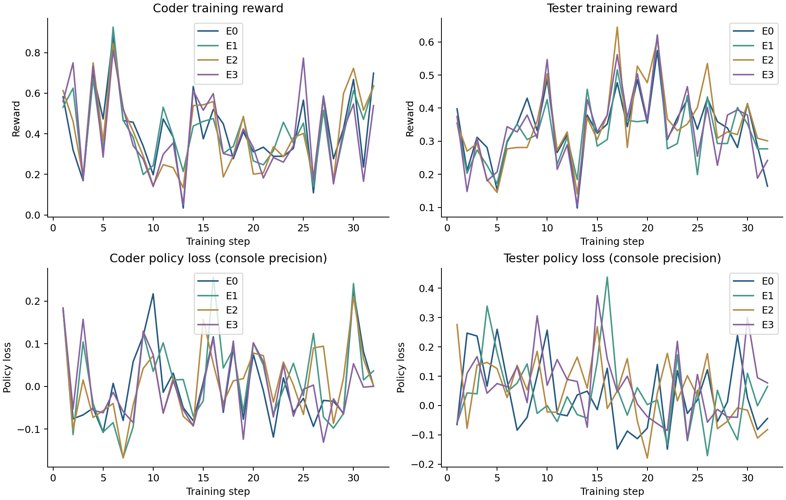
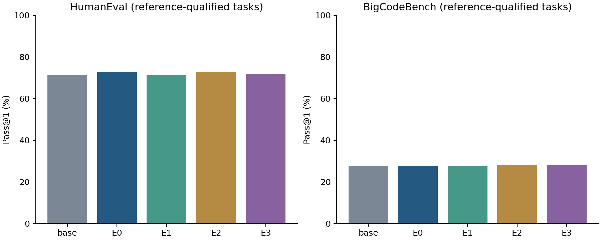
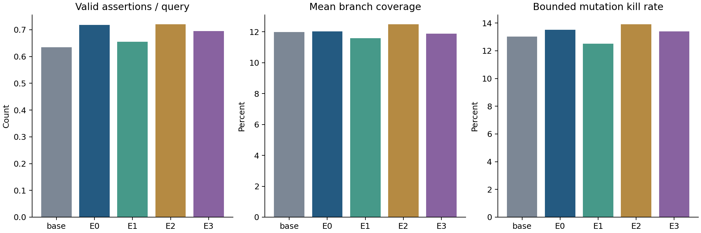

# Adversarial Co-Training：固定预算实验报告

本报告比较未训练模型、Code-A1 baseline 和三组执行反馈改进。结论仅覆盖本轮 32-step、单 seed 的受限规模实验；不等同于论文完整预算复现或官方 leaderboard 分数。

## 目标与实现

检验向 tester 提供候选代码的分支覆盖率与返回时局部变量，是否在固定模型输出预算下改善测试质量和 coder 表现。四组共享基础模型、128 个训练问题、32 steps、batch 4、coder/tester 各 n=2、1,024 输出 token 上限。学习率 1e-6，KL 系数 0.001。

E0 直接运行官方 Code-A1；E1 提供 coverage，E2 提供 runtime values，E3 提供两者。增强组每份候选代码执行前两个固定训练测试作为探针，新增反馈最多 384 tokens；不把测试断言预期答案或参考实现交给 tester。反馈输入与执行是额外成本。

完整协议见 [EXPERIMENT_PROTOCOL.md](EXPERIMENT_PROTOCOL.md)，上游机制核对见 [CODE_A1_METHOD.md](CODE_A1_METHOD.md)。

训练子集 128 条与三个评测集共 1504 条参考实现进行 AST 精确对照（去除 docstring、注释与格式，保留标识符及 imports），发现 0 个相同源码匹配；训练/评测未解析数为 0/0。这不能排除改写、语义重复或基础模型预训练污染，详见 `artifacts/study/overlap-audit.json`。

## 训练结果与可复现性

四组均需具有 1–32 步两模型的有限梯度记录、最终 HF 权重和逐轮 rollout，报告脚本在这些证据缺失时退出。模型权重、数据和原始日志位于 Git 忽略的 `artifacts/`、`data/` 和 `models/` 目录，通过脚本复现。

| 组 | 新增反馈 | 训练作业 | 最终 step |
| --- | --- | --- | --- |
| E0 | 无 | 6888252 | 32 |
| E1 | Coverage | 6888295 | 32 |
| E2 | Runtime values | 6888296 | 32 |
| E3 | 两者结合 | 6888297 | 32 |



训练 reward 是当前 coder/tester 交互下的信号，分布会随两模型变化，不能单独作为独立 benchmark 改善的证据。Loss 为 GRPO policy loss，可为负数，其符号或绝对大小也不能直接判定模型优劣。本轮 console-only 曲线保留三位小数。

## Coder 评测

所有模型采用相同 greedy prompt、每题一个输出、最大 1,024 tokens。HumanEval 共 164 条，BigCodeBench v0.1.4 Instruct 共 1,140 条；每个候选执行同一版本的完整测试。先校准参考实现，分别列出全量原始通过率与参考实现通过子集上的通过率。环境不合格任务不被默认为模型失败证据。

| 模型 | HumanEval 原始 pass@1 | HumanEval 校准子集 | BigCodeBench 原始 pass@1 | BigCodeBench 校准子集 |
| --- | --- | --- | --- | --- |
| base | 71.34% | 71.34% | 26.23% | 27.51% |
| E0 | 72.56% | 72.56% | 26.49% | 27.78% |
| E1 | 71.34% | 71.34% | 26.23% | 27.51% |
| E2 | 72.56% | 72.56% | 27.02% | 28.33% |
| E3 | 71.95% | 71.95% | 26.75% | 28.06% |

参考校准：HumanEval 164/164；BigCodeBench 1087/1140。失败任务与原始 stderr 保存在 `artifacts/study/reference-harnesses.jsonl`。



## Tester 评测与消融

采用 ULT Lite 固定 200 个函数，K=2 轮，每轮最多 8 条 assert。第二轮看到第一轮输出；所有模型的测试阶段都不额外提供执行反馈，以比较训练后能力。只在参考函数上通过的测试参与 coverage 与 mutant kill。每函数最多 4 个固定 AST 比较/算术/布尔变异体，属于有界 mutation 指标，不是官方完整 Cosmic-Ray 分数。

| 模型 | 有效测试/提交数 | 有效测试/query | 平均行覆盖率 | 平均分支覆盖率 | 有界 mutation score | 执行测量失败函数 |
| --- | --- | --- | --- | --- | --- | --- |
| base | 254/1790 | 0.635 | 17.21% | 11.98% | 13.02% | 1 |
| E0 | 287/1954 | 0.718 | 16.54% | 12.02% | 13.53% | 1 |
| E1 | 262/1845 | 0.655 | 15.71% | 11.59% | 12.52% | 1 |
| E2 | 288/1930 | 0.720 | 17.63% | 12.48% | 13.91% | 1 |
| E3 | 278/2015 | 0.695 | 16.75% | 11.87% | 13.40% | 1 |

每轮最多计 8 个顶层 assert；语法错误、重定义函数或没有顶层 assert 的整轮输出计为一次无效提交。有效测试/query 始终以固定 400 次 query 为分母。平均覆盖率按 200 个函数等权；测量失败函数取 0，没有分支的函数在分支覆盖率中也取 0，行覆盖率另报。测试有效率与 mutation 总体比率基于成功返回测量数据的函数，须结合失败函数数量阅读。逐函数配对分析对每个函数等权，测量失败或没有变异体的函数取 0；其 mutation 差异与上表按变异体汇总的比率之差不必相同。



## 相对 baseline 的配对差异

下表对同一题目作配对差，使用 2,000 次按题 bootstrap，列出 95% 区间。它刻画题目抽样不确定性，不包含训练 seed 方差；四组共享同一训练 seed，且未作多重比较校正。

| 组 | 指标 | 差异 | 95% 区间 |
| --- | --- | --- | --- |
| E1 | HumanEval | -1.220 pp | [-4.268, +1.220] pp |
| E1 | BigCodeBench | -0.276 pp | [-1.196, +0.552] pp |
| E1 | valid_tests_per_query | -0.062 | [-0.188, +0.040] |
| E1 | bounded_mutation_score | -0.917 pp | [-2.750, +0.833] pp |
| E1 | branch_coverage | -0.430 pp | [-1.877, +1.009] pp |
| E2 | HumanEval | +0.000 pp | [-1.829, +1.829] pp |
| E2 | BigCodeBench | +0.552 pp | [-0.368, +1.472] pp |
| E2 | valid_tests_per_query | +0.003 | [-0.130, +0.115] |
| E2 | bounded_mutation_score | +0.417 pp | [-1.375, +2.500] pp |
| E2 | branch_coverage | +0.456 pp | [-1.145, +2.179] pp |
| E3 | HumanEval | -0.610 pp | [-1.829, +0.000] pp |
| E3 | BigCodeBench | +0.276 pp | [-0.460, +1.104] pp |
| E3 | valid_tests_per_query | -0.022 | [-0.150, +0.085] |
| E3 | bounded_mutation_score | -0.042 pp | [-1.833, +1.667] pp |
| E3 | branch_coverage | -0.151 pp | [-1.617, +1.319] pp |

## 反馈成本与失败案例

| 组 | Trace 数 | 额外输入 tokens | 探针执行耗时合计（秒） | 采集错误 |
| --- | --- | --- | --- | --- |
| E1 | 256 | 19170 | 131.1 | 33 |
| E2 | 256 | 35280 | 145.0 | 33 |
| E3 | 256 | 47501 | 145.7 | 38 |

评测生成预算实际用量（coder 1,304 次输出，tester 400 次输出；长度上限是生成的停止原因，可能产生不完整代码）：

| 模型 | Coder 输入/输出 tokens | Coder 达到长度上限 | Tester 输入/输出 tokens | Tester 达到长度上限 | 超长输入失败 |
| --- | --- | --- | --- | --- | --- |
| base | 255094/237542 | 2/1304 | 312808/289057 | 190/400 | 0 |
| E0 | 255094/238379 | 3/1304 | 301995/266217 | 153/400 | 0 |
| E1 | 255094/237296 | 2/1304 | 308791/281672 | 184/400 | 0 |
| E2 | 255094/239444 | 3/1304 | 302041/270748 | 161/400 | 0 |
| E3 | 255094/236830 | 2/1304 | 297666/262181 | 152/400 | 0 |

实验后 Scratch 配额：263.9/300 GiB，剩余 36.1 GiB；文件 896,514/1,000,000。该配额由用户整个 Scratch 共享，运行前保护阈值为 20 GiB / 20,000 文件。

三个增强组的探针数量和采集设置一致，实际执行成本与反馈输入长度不同；执行耗时合计是请求耗时之和，不等于并发后的 walltime。逐条反馈和源码关联见 `artifacts/study/E*/feedback/`。原始 generation 文件记录真实 prompt/output token 数及截断状态。

本轮 Slurm 已分配 GPU 用量合计 **3.866 GPU-hours**，逐作业实际 GPU 类型、时长、退出状态见 `artifacts/study/resources.json`。E1 训练使用 H200，其余三组使用 H100；不同硬件的数值与生成差异未被单 seed 控制，不能将组间差异完全归因于反馈。base CPU 评分申请 8 核，后四组申请 4 核，均为 4 个沙箱并发；也不能把 walltime 差直接解释为算法收益。

代表性配对例子（先按 task id 排序选取，未只挑成功案例）：

- E1 / HumanEval：新增通过 HumanEval/107, HumanEval/75；相对退步 HumanEval/65, HumanEval/84, HumanEval/93。
- E1 / BigCodeBench：新增通过 BigCodeBench/1048, BigCodeBench/174, BigCodeBench/197；相对退步 BigCodeBench/1097, BigCodeBench/1135, BigCodeBench/184。
- E2 / HumanEval：新增通过 HumanEval/107；相对退步 HumanEval/95。
- E2 / BigCodeBench：新增通过 BigCodeBench/1017, BigCodeBench/1078, BigCodeBench/169；相对退步 BigCodeBench/11, BigCodeBench/1118, BigCodeBench/164。
- E3 / HumanEval：新增通过 无；相对退步 HumanEval/65。
- E3 / BigCodeBench：新增通过 BigCodeBench/1049, BigCodeBench/1078, BigCodeBench/169；相对退步 BigCodeBench/11, BigCodeBench/1135, BigCodeBench/588。

## 结论与局限

E1 的逐函数有界 mutation score 相对 E0 平均差异为 -0.917 个百分点；区间跨越 0，当前证据不足以确认稳定改善。单 seed、小训练集及受限生成长度限制了该结论的外推。

E2 的逐函数有界 mutation score 相对 E0 平均差异为 +0.417 个百分点；区间跨越 0，当前证据不足以确认稳定改善。单 seed、小训练集及受限生成长度限制了该结论的外推。

E3 的逐函数有界 mutation score 相对 E0 平均差异为 -0.042 个百分点；区间跨越 0，当前证据不足以确认稳定改善。单 seed、小训练集及受限生成长度限制了该结论的外推。

受限训练与论文配置有明显差异；完整 BigCodeBench 的部分依赖、网络或参考测试可能不适配本沙箱；ULT 采用 assert 接口与少量变异算子，存在等价变异体及分母选择限制。没有把未提升、截断、超时或测量失败隐藏为成功。后续应增加训练规模和 seed，扩大反馈探针与 mutation 算子，并在完整官方评测环境复核。

## 复现入口

```bash
source scripts/activate.sh rl
python scripts/check_quota.py
# 仅限已准备环境与数据、尚无 jobs.json 的全新实验目录：
python scripts/submit_study.py --wandb
# --wandb 要求已有明确授权的 metrics 配置；不上传时省略。
# 重新分析本轮已有完整结果：
python scripts/record_study_resources.py
python scripts/analyze_study.py
```

完整作业映射：`artifacts/study/jobs.json`；完整统计与训练曲线：`artifacts/study/analysis.json`。重新运行请使用独立输出目录或先归档本轮产物，生成脚本会拒绝覆盖已有原始输出。

## W&B 监控

项目：[6257-adversarial-co-training](https://wandb.ai/mushroom_yeren/6257-adversarial-co-training/workspace)。按用户指定范围，仅同步数值训练指标、配置、资源统计和评测汇总；不上传原始题目、模型输出、逐条日志、数据集或权重。

Loss 历史位于 `actor_a/pg_loss`、`actor_b2/pg_loss`；最终评测汇总在 `eval/` 和 `evaluation/`。本轮较早的 console-only 数据只有三位小数，精度限制保留在 run config 中；后续结构化 metrics stream 可记录完整精度。最终云端读回验收记录为 `artifacts/study/wandb-final-verified.json`。
