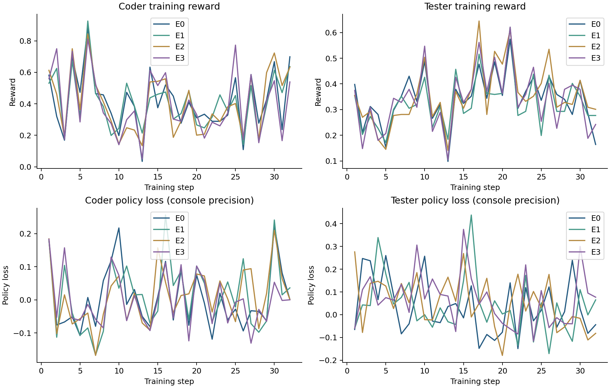
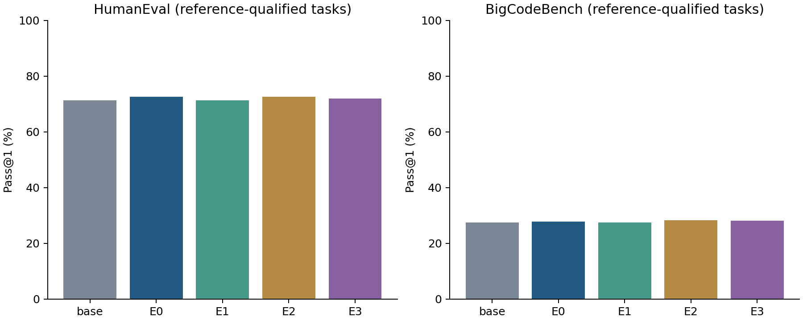
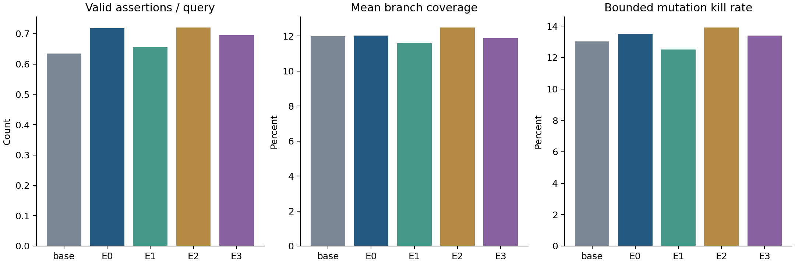

# Adversarial Co-Training: Fixed-Budget Study Report

This report compares the untrained model, the Code-A1 baseline, and three execution-feedback variants. Conclusions apply only to this resource-limited, 32-step, single-seed study; they do not establish full-budget paper reproduction or official leaderboard scores.

## Goal and implementation

Test whether branch coverage and return-time locals from candidate code improve tester quality and coder performance under a fixed output budget. All four arms share the base model, 128 training problems, 32 steps, batch size 4, n=2 per coder/tester, and a 1,024-token response cap. The learning rate is 1e-6 and the KL coefficient is 0.001.

E0 runs official Code-A1 directly. E1 supplies coverage, E2 runtime values, and E3 both. Each enhanced arm probes candidate code with the first two fixed training tests and adds at most 384 feedback tokens. Expected assertion answers and reference implementations are excluded from tester prompts. Feedback input and execution add costs.

See [EXPERIMENT_PROTOCOL.md](EXPERIMENT_PROTOCOL.md) for the full protocol and [CODE_A1_METHOD.md](CODE_A1_METHOD.md) for the upstream implementation review.

An exact AST comparison checked 128 training sources against 1504 reference implementations across the three evaluation sets, removing docstrings/comments/formatting while retaining identifiers and imports. It found 0 identical-source matches; unparsed training/evaluation sources: 0/0. This does not rule out paraphrased or semantic overlap, or base-model pretraining contamination. See `artifacts/study/overlap-audit.json`.

## Training evidence and reproducibility

All four arms must have finite-gradient records for both models at steps 1–32, final HF weights, and per-round rollouts; the report script exits if this evidence is missing. Weights, data, and raw logs are in Git-ignored `artifacts/`, `data/`, and `models/` directories and are reproduced through the scripts.

| Arm | Added feedback | Training job | Final step |
| --- | --- | --- | --- |
| E0 | None | 6888252 | 32 |
| E1 | Coverage | 6888295 | 32 |
| E2 | Runtime values | 6888296 | 32 |
| E3 | Both | 6888297 | 32 |



Training rewards reflect the current coder/tester interaction and change as both models change; they alone are not evidence of benchmark improvement. GRPO policy loss can be negative, and its sign or magnitude does not directly rank model quality. This study's console-only curves retain three decimals.

## Coder evaluation

All variants use the same greedy prompts, one output per task, and a 1,024-token cap. HumanEval has 164 tasks; BigCodeBench v0.1.4 Instruct has 1,140. Each candidate runs the same complete tests. Reference implementations are calibrated first. Report both the raw full-denominator pass rate and the rate on the subset whose reference implementations pass; a failed reference calibration is not treated as conclusive evidence of model failure.

| Variant | HumanEval raw pass@1 | HumanEval qualified subset | BigCodeBench raw pass@1 | BigCodeBench qualified subset |
| --- | --- | --- | --- | --- |
| base | 71.34% | 71.34% | 26.23% | 27.51% |
| E0 | 72.56% | 72.56% | 26.49% | 27.78% |
| E1 | 71.34% | 71.34% | 26.23% | 27.51% |
| E2 | 72.56% | 72.56% | 27.02% | 28.33% |
| E3 | 71.95% | 71.95% | 26.75% | 28.06% |

Reference calibration: HumanEval 164/164; BigCodeBench 1087/1140. Failed task IDs and raw stderr are retained in `artifacts/study/reference-harnesses.jsonl`.



## Tester evaluation and ablations

ULT Lite uses the fixed 200 functions, K=2 rounds, and at most 8 assertions per round. Round two sees round one's output. No variant receives extra execution feedback during evaluation, so the comparison measures capabilities after training. Only tests passing on the reference function contribute to coverage and mutant kills. Each function has at most 4 deterministic AST comparison/arithmetic/Boolean mutants. This is a bounded mutation metric, not the official full Cosmic-Ray score.

| Variant | Valid/submitted tests | Valid tests/query | Mean line coverage | Mean branch coverage | Bounded mutation score | Measurement failures |
| --- | --- | --- | --- | --- | --- | --- |
| base | 254/1790 | 0.635 | 17.21% | 11.98% | 13.02% | 1 |
| E0 | 287/1954 | 0.718 | 16.54% | 12.02% | 13.53% | 1 |
| E1 | 262/1845 | 0.655 | 15.71% | 11.59% | 12.52% | 1 |
| E2 | 288/1930 | 0.720 | 17.63% | 12.48% | 13.91% | 1 |
| E3 | 278/2015 | 0.695 | 16.75% | 11.87% | 13.40% | 1 |

Count at most 8 top-level assertions per round. A whole output with syntax errors, redefined functions, or no top-level assertions counts as one invalid submission. Valid tests/query always uses the fixed denominator of 400 queries. Mean coverage weights all 200 functions equally, with zero for measurement failures; branchless functions also receive zero branch coverage, and line coverage is reported separately. Test-validity and aggregate mutation ratios use successfully measured functions and must be read alongside failure counts. Paired analysis instead weights per-function ratios equally, assigning zero to failures or functions with no mutants; its mutation difference need not equal the difference between the aggregate ratios above.



## Paired differences from the baseline

Pair the same tasks and report 95% intervals from 2,000 task bootstrap resamples. These describe task-sampling uncertainty, not training-seed variance. All four arms use the same training seed, and no multiple-comparison correction is applied.

| Arm | Metric | Difference | 95% interval |
| --- | --- | --- | --- |
| E1 | HumanEval | -1.220 pp | [-4.268, +1.220] pp |
| E1 | BigCodeBench | -0.276 pp | [-1.196, +0.552] pp |
| E1 | valid_tests_per_query | -0.062 | [-0.188, +0.040] |
| E1 | bounded_mutation_score | -0.917 pp | [-2.750, +0.833] pp |
| E1 | branch_coverage | -0.430 pp | [-1.877, +1.009] pp |
| E2 | HumanEval | +0.000 pp | [-1.829, +1.829] pp |
| E2 | BigCodeBench | +0.552 pp | [-0.368, +1.472] pp |
| E2 | valid_tests_per_query | +0.003 | [-0.130, +0.115] |
| E2 | bounded_mutation_score | +0.417 pp | [-1.375, +2.500] pp |
| E2 | branch_coverage | +0.456 pp | [-1.145, +2.179] pp |
| E3 | HumanEval | -0.610 pp | [-1.829, +0.000] pp |
| E3 | BigCodeBench | +0.276 pp | [-0.460, +1.104] pp |
| E3 | valid_tests_per_query | -0.022 | [-0.150, +0.085] |
| E3 | bounded_mutation_score | -0.042 pp | [-1.833, +1.667] pp |
| E3 | branch_coverage | -0.151 pp | [-1.617, +1.319] pp |

## Feedback costs and failure cases

| Arm | Traces | Extra input tokens | Summed probe time (seconds) | Collection errors |
| --- | --- | --- | --- | --- |
| E1 | 256 | 19170 | 131.1 | 33 |
| E2 | 256 | 35280 | 145.0 | 33 |
| E3 | 256 | 47501 | 145.7 | 38 |

Actual evaluation generation usage: 1,304 coder outputs and 400 tester outputs. A length-limit stop can leave code incomplete.

| Variant | Coder input/output tokens | Coder length-limited | Tester input/output tokens | Tester length-limited | Oversized-input failures |
| --- | --- | --- | --- | --- | --- |
| base | 255094/237542 | 2/1304 | 312808/289057 | 190/400 | 0 |
| E0 | 255094/238379 | 3/1304 | 301995/266217 | 153/400 | 0 |
| E1 | 255094/237296 | 2/1304 | 308791/281672 | 184/400 | 0 |
| E2 | 255094/239444 | 3/1304 | 302041/270748 | 161/400 | 0 |
| E3 | 255094/236830 | 2/1304 | 297666/262181 | 152/400 | 0 |

Post-study Scratch quota: 263.9/300 GiB used, 36.1 GiB free; 896,514/1,000,000 files. This quota is shared by the user's entire Scratch space. Startup guards reserve 20 GiB and 20,000 files.

The three feedback arms use the same probe counts and collection settings, but actual execution costs and feedback lengths differ. Summed request durations are not concurrent walltime. Per-example feedback/code links are in `artifacts/study/E*/feedback/`; raw generation files record actual prompt/output tokens and truncation status.

Actual Slurm allocation totals **3.866 GPU-hours** for this study. Per-job GPU type, duration, and exit state are in `artifacts/study/resources.json`. E1 trained on H200; the other three arms trained on H100. A single seed does not control hardware-dependent numerical/generation differences, so differences cannot be attributed entirely to feedback. Base CPU scoring requested 8 cores, later variants 4, all with four concurrent sandboxes; walltime differences do not establish algorithmic efficiency.

Representative paired examples, selected by sorted task ID rather than only showing successes:

- E1 / HumanEval: newly passed HumanEval/107, HumanEval/75; regressed HumanEval/65, HumanEval/84, HumanEval/93.
- E1 / BigCodeBench: newly passed BigCodeBench/1048, BigCodeBench/174, BigCodeBench/197; regressed BigCodeBench/1097, BigCodeBench/1135, BigCodeBench/184.
- E2 / HumanEval: newly passed HumanEval/107; regressed HumanEval/95.
- E2 / BigCodeBench: newly passed BigCodeBench/1017, BigCodeBench/1078, BigCodeBench/169; regressed BigCodeBench/11, BigCodeBench/1118, BigCodeBench/164.
- E3 / HumanEval: newly passed none; regressed HumanEval/65.
- E3 / BigCodeBench: newly passed BigCodeBench/1049, BigCodeBench/1078, BigCodeBench/169; regressed BigCodeBench/11, BigCodeBench/1135, BigCodeBench/588.

## Conclusions and limitations

E1: mean per-function bounded mutation-score difference from E0 is -0.917 percentage points. The interval includes zero; current evidence does not establish a stable improvement. One seed, a small training subset, and limited generation length restrict generalization.

E2: mean per-function bounded mutation-score difference from E0 is +0.417 percentage points. The interval includes zero; current evidence does not establish a stable improvement. One seed, a small training subset, and limited generation length restrict generalization.

E3: mean per-function bounded mutation-score difference from E0 is -0.042 percentage points. The interval includes zero; current evidence does not establish a stable improvement. One seed, a small training subset, and limited generation length restrict generalization.

The training budget differs substantially from the paper. Some BigCodeBench dependencies, network requirements, or reference tests do not fit this sandbox. ULT uses an assertion interface and a small mutation-operator set, with equivalent-mutant and denominator limitations. Lack of improvement, truncation, timeouts, and measurement failures remain visible in the results. Future work should increase training scale and seeds, expand probes/mutation operators, and verify results in the complete official evaluation environment.

## Reproduction entrypoints

```bash
source scripts/activate.sh rl
python scripts/check_quota.py
# Fresh workspace only: environment/data prepared and no jobs.json present.
python scripts/submit_study.py --wandb
# --wandb requires an explicitly authorized metrics configuration; omit for no upload.
# Reanalyze the complete existing study:
python scripts/record_study_resources.py
python scripts/analyze_study.py
```

Job mapping: `artifacts/study/jobs.json`; complete statistics and curves: `artifacts/study/analysis.json`. Use a separate workspace or archive this study before rerunning; generation refuses to overwrite original outputs.

## W&B monitoring

Project: [6257-adversarial-co-training](https://wandb.ai/mushroom_yeren/6257-adversarial-co-training/workspace). Uploads are limited to the user-approved numeric training metrics, configurations, resource statistics, and aggregate evaluation summaries. Raw prompts, model outputs, per-example logs, datasets, and weights are excluded.

Loss histories: `actor_a/pg_loss` and `actor_b2/pg_loss`. Final evaluation summaries: `eval/` and `evaluation/`. Earlier console-only data has three-decimal precision, documented in the run configuration; future structured streams can preserve full precision. Final cloud readback evidence is `artifacts/study/wandb-final-verified.json`.
